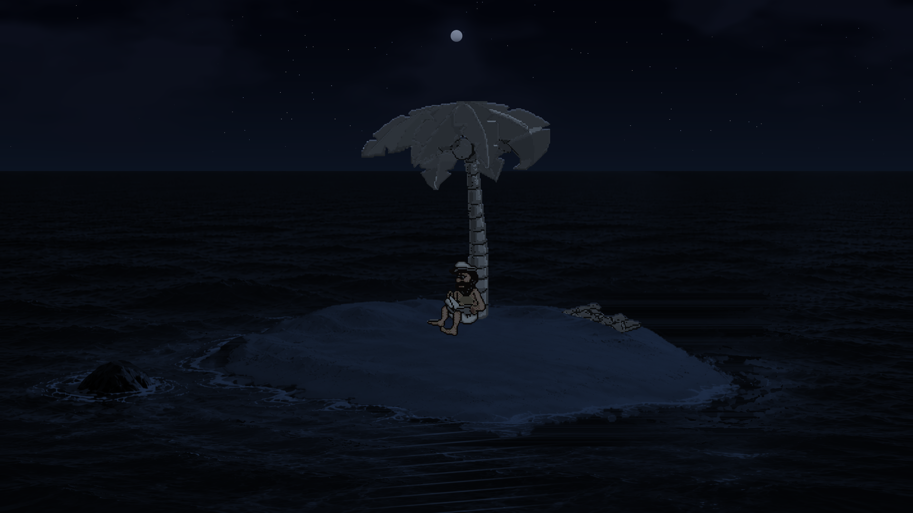

# Johnny Castaway HD-2D — Linux, C99 et Vulkan

Remaster expérimental de **Johnny Castaway / Screen Antics (1992)** : les
scripts, les gags et les sprites originaux évoluent dans un décor moderne animé
par GPU. Le projet conserve le dessin rétro de Johnny, sa casquette, son short
et sa barbe, avec une palette plus chaude et un éclairage adapté à l’île.

**État actuel :** 79 scènes et 2 392 sprites d’origine, rendu classique ou moderne,
bruitages originaux, mer et rivage animés, ciel jour/nuit avec étoiles, palmier
original et lumière du feu. Cible testée : Linux, Radeon 780M, pilote RADV.
Le rendu est une composition **2D / 2.5D**, avec une illustration de fond et des
shaders ; il ne s’agit pas d’une scène entièrement modélisée en 3D.



## Sommaire

- [Démarrage rapide](#démarrage-rapide)
- [Installation et données originales](#installation-et-données-originales)
- [Fonctionnalités](#fonctionnalités)
- [Commandes et prévisualisations](#commandes-et-prévisualisations)
- [Toutes les options](#toutes-les-options)
- [Progression et configuration](#progression-et-configuration)
- [Compilation](#compilation)
- [Architecture](#architecture)
- [Tests et diagnostics](#tests-et-diagnostics)
- [Performances et taille](#performances-et-taille)
- [Limites connues](#limites-connues)
- [Origine du portage et licences](#origine-du-portage-et-licences)

## Démarrage rapide

Cloner le dépôt, ajouter les trois fichiers originaux décrits ci-dessous, puis
compiler et lancer la démonstration :

```sh
git clone https://github.com/Nide96/johnny-hd2d.git
cd johnny-hd2d
# Ajouter RESOURCE.MAP, RESOURCE.001 et SCRANTIC.SCR dans assets/original/
make
./preview-living.sh --fullscreen
```

Cette démonstration joue les scènes normales avec une journée visuelle de deux
minutes. Pour commencer immédiatement sous les étoiles :

```sh
./preview-stars.sh --fullscreen
```

Pour une session normale, avec l’heure locale et la progression persistante :

```sh
./johnny-hd2d --modern --fullscreen
```

**Échap** ferme l’application. **M** active ou désactive le son. La fenêtre
standard est redimensionnable ; `--fullscreen` choisit le plein écran au démarrage.
Toutes les commandes relatives ci-dessous supposent que le terminal se trouve
dans le dossier du projet. Les scripts localisent leur exécutable par leur propre
chemin et peuvent aussi être lancés depuis un autre dossier.

## Installation et données originales

### Environnement nécessaire

- Linux avec Vulkan fonctionnel et les bibliothèques correspondant au GPU.
- X11 ; sous Hyprland/Wayland, une session **XWayland** disponible pour la fenêtre.
- Bibliothèques d’exécution X11, Xi, Xcursor, Vulkan, ALSA et bibliothèques C usuelles.
- ALSA pour le son ; PipeWire peut fournir la sortie ALSA, comme sur le poste testé.

Les en-têtes Sokol sont fournis dans `vendor/`. Rust, SDL et Wine ne sont pas
nécessaires à l’exécution. Python ne sert qu’aux outils de développement.

### Fichiers du jeu

Placer les trois fichiers de sa propre copie du jeu dans :

```text
assets/original/
├── RESOURCE.MAP
├── RESOURCE.001
└── SCRANTIC.SCR
```

Respecter les noms et la casse. Ces données originales **ne sont pas incluses
dans l’archive distribuable**. `SCRANTIC.SCR` est lu comme une source de tables et
de sons ; le programme Windows n’est pas exécuté.

Un autre emplacement est accepté :

```sh
./johnny-hd2d --data /chemin/vers/les/originaux --modern --fullscreen
```

`--data` change le dossier des données originales, pas celui du décor moderne.
Le décor par défaut est cherché à côté de l’exécutable dans
`assets/modern/island-registered-v2.jcr`. Il faut conserver cette arborescence
quand on déplace le programme. `--modern-plate` permet un chemin explicite.

## Fonctionnalités

### Logique et fidélité rétro

- Portage C99 du cœur logique : ressources compressées, scripts ADS/TTM,
  déplacements, sélection des scènes, calendrier et progression sur 11 chapitres.
- Catalogue de **79 scènes**, **117 feuilles BMP** et **2 392 sprites** originaux.
- Canvas logique indexé **640 × 480**, clips et assemblages d’origine conservés.
- Deux horloges héritées : composition à **55 ms**, timer des scripts à **16 ms**.
- Présentation GPU indépendante de la cadence de composition, avec interpolation
  sub-pixel des déplacements compatibles entre deux états. Cette interpolation
  ne fabrique pas de poses intermédiaires ni ne change la chronologie des gags.
- Graine RNG et calendrier injectables pour rejouer un cas de manière reproductible.

### Deux présentations

| Mode | Présentation |
| --- | --- |
| `--classic` | Présentation indexée d’origine en 4:3 ; mode par défaut. |
| `--modern` | Décor large 16:9, sprites originaux harmonisés, éclairage et environnement animés. |

La fenêtre initiale fait 1280 × 960 en classique et 1280 × 720 en moderne.
Le viewport conserve le rapport du mode choisi ; des bandes peuvent apparaître
sur un écran d’un autre format. Le rendu suit la taille de sortie et le mode HiDPI.

### Johnny et les autres sprites

Johnny est rendu **exclusivement depuis l’atlas indexé R8 original**, dans les
scènes normales comme dans la démonstration de marche. Il n’y a plus de bascule
vers un Johnny peint au milieu d’une animation.

Le matériau GPU moderne apporte :

- palette harmonisée, peau chaude, blancs légèrement ivoire et traits brun profond ;
- fusion des damiers détectés en lumière linéaire, y compris les petits motifs 2 × 2 ;
- filtre directionnel de voisinage 3 × 3 pour atténuer les escaliers diagonaux ;
- atténuation des éclats blancs isolés dans les parties sombres de Johnny ;
- traitement sobre de Johnny : biseautage désactivé et rim-light fortement réduit ;
- conservation des grands blancs du short et de la casquette, et des yeux lisibles ;
- éclairage ambiant continu, relief léger et lumière de contour selon le matériau ;
- traits primitifs, dont le fil de pêche, avec couverture alpha à la résolution de sortie.

Le traitement spécifique de la peau et des détails de Johnny cible ses ressources.
Les accessoires et les autres personnages conservent leur matériau ; les sprites
composites gardent leur assemblage et leur palette partagée. Le filtre améliore
la présentation à grande taille sans inventer de nouveaux détails du dessin.

### Palmier et contacts avec les animations

Le palmier utilise désormais **toujours les sprites originaux**, également en
mode moderne. Son tronc, sa couronne, les morceaux animés et les feuilles détachées
partagent ainsi la géométrie des scripts. Le gag de lecture et de noix de coco
n’alterne plus entre une couronne peinte et un morceau rétro.

Un vent léger anime les palmes, en gardant les attaches fixes. Il est désactivé
dès le début des scènes sensibles au tronc, aux noix de coco ou à la couronne,
pour préserver leurs contacts et leur mouvement comique.

Les anciennes planches PNG/JCR de Johnny et la maquette peinte du palmier ont
été supprimées : **44 fichiers, 168,25 Mio retirés**. Les métadonnées et rapports
restants dans `assets/characters/` sont historiques. Les options anciennes
`--johnny-hd` et `--palm-original` ne réactivent aucune texture retirée.

### Mer, rivage et sable

- Houle et rides à plusieurs fréquences, avec déformation UV réservée à l’eau.
- Reflets du soleil et de la lune suivant leur position visuelle.
- Écume qui avance et reflue sur la plage ; bordure de sable humide.
- Masque du rivage calculé au démarrage à partir du décor fourni, avec une
  distance signée pour les transitions. Le sable intérieur et le rocher sont
  exclus de la déformation de la mer.
- Ombre légère des nuages sur l’île.

Le fond artistique reste une illustration : les shaders animent sa présentation,
pas une simulation physique complète de vagues ou de terrain.

### Ciel, jour/nuit et feu

- Ciel procédural avec transitions continues jour, crépuscule et nuit.
- Deux couches de nuages mobiles à vitesses différentes.
- Soleil, lune et halos analytiques.
- Étoiles fixes dans le ciel, scintillement lent, atténuation par les nuages et
  disparition progressive à l’aube.
- Lueur chaude du vrai feu des scènes 16–19 sur le sable, les sprites et le palmier.
- Scintillement commun du feu, braises discrètes et flamme dédiée lisible la nuit.

L’horloge graphique est indépendante de la VM. `--time-lapse` accélère le jour
visuel ; `--freeze-scene` laisse vivre le décor autour d’une pose figée.
Les phases d’animation bouclent à 4 096 secondes sans saut au raccord testé.
Les halos sont calculés dans les passes existantes : il n’y a pas de bloom HDR
à flou multipasse dans cette version.

### Ombres

Les sprites debout ont une ombre projetée et cisaillée. Les poses couchées,
assises et le radeau utilisent une ombre de contact proche de leur silhouette.
Le masque du sable limite les débordements dans l’eau.

Les ombres grises d’origine identifiées dans **121 sprites** sont neutralisées
uniquement dans les copies GPU, pour éviter le doublon avec les ombres modernes.
Les vêtements et éléments gris utiles sont préservés. Les zones non auditées
restent traitées de manière conservatrice.

### Audio

- **23 bruitages originaux** PCM mono 8 bits à 11 025 Hz.
- Sortie Sokol Audio / ALSA ; rééchantillonnage linéaire vers la fréquence acceptée
  par le périphérique et duplication sur les canaux stéréo.
- Événements observés à chaque pas de VM, y compris lors des rattrapages.
- Dernier bruitage prioritaire : un nouveau son interrompt le précédent.
- Volume d’exécution de 0 à 100, par défaut 70 ; option muet et touche **M**.
- Aucun périphérique audio ouvert en headless ; une erreur d’ouverture audio
  est signalée sans arrêter l’animation.

Il n’y a pas de musique ni d’ambiance de vagues continue ajoutée. Une scène peut
rester silencieuse longtemps ; les sauts avec `--skip-steps` ne rejouent pas les
bruitages déjà passés. Les vidéos de validation peuvent être muettes.

## Commandes et prévisualisations

### Lanceurs fournis

| Lanceur | Fonction |
| --- | --- |
| `preview-living.sh` | Scènes normales ; départ à 17 h, journée visuelle en 120 s. |
| `preview-stars.sh` | Scènes normales ; départ à minuit avec étoiles. |
| `preview-modern.sh` | Scènes normales, calendrier fixé à midi. |
| `preview-hybrid.sh` | Pêche, scène 20 au pas 65, avant son premier bruitage utile. |
| `preview-sleep.sh` | Repos/sommeil, scène 51, chapitre 6, au pas 150. |
| `preview-reading-palm.sh` | Gag lecture/noix de coco, scène 35 au pas 125. |
| `preview-reading-hd.sh [scène]` | Lecture, scène 34 par défaut ; 35 pour le gag. |
| `preview-fishing-hd.sh [scène]` | Scène de pêche choisie ; 20 par défaut. |
| `preview-scenes-hd.sh [scène]` | Scène 51 par défaut ; permet notamment 52 et 53. |
| `preview-walk-hd.sh` | Boucle de marche isolée, sans progression de l’histoire. |

Les noms contenant `hd` sont historiques : le personnage reste en sprites R8.
Tous ces lanceurs emploient un calendrier fixe et préservent la sauvegarde réelle.
Pour les scripts acceptant un numéro de scène, le passer **avant** les options :

```sh
./preview-reading-hd.sh 35 --fullscreen
./preview-scenes-hd.sh 52 --fullscreen
```

### Exemples directs

```sh
# Présentation d’origine
./johnny-hd2d --classic --fullscreen

# Scène de lecture reproductible
./johnny-hd2d --modern --scene 34 --seed 1 --clock 2026-10-18T12:00 --fullscreen

# Feu de camp, nuit et pose figée ; l’environnement continue de bouger
./johnny-hd2d --modern --scene 16 --skip-steps 400 --seed 4242 --clock 2026-10-18T00:00 --freeze-scene --fullscreen

# Désactiver l’interpolation pour comparer les déplacements discrets
./preview-hybrid.sh --fullscreen --no-interpolation

# Comparer avec le ciel illustré et la présentation antérieure du décor
./preview-modern.sh --fullscreen --no-decor-fx

# Lister le catalogue
./johnny-hd2d --list-scenes
```

`--scene` force le choix d’une scène de test ; sa durée et sa fin suivent ses
scripts. `--walk-demo` est une démonstration isolée et ne montre pas les autres scènes.

## Toutes les options

La référence exécutable est `./johnny-hd2d --help`.

| Option | Effet et contraintes |
| --- | --- |
| `--modern` | Active la présentation moderne. |
| `--classic` | Active la présentation classique ; valeur par défaut. |
| `--fullscreen` | Ouvre directement en plein écran. |
| `--data DIR` | Dossier des trois fichiers originaux. |
| `--modern-plate FILE` | Remplace le décor par un fichier JCR1 ; le calage doit rester compatible. |
| `--palm-original` | Compatibilité avec les anciens lanceurs ; le palmier original est déjà systématique. |
| `--johnny-hd` | Compatibilité historique, nécessite le mode moderne ; Johnny reste en R8. |
| `--walk-demo` | Marche isolée ; implique le mode moderne et midi si aucune horloge n’est fournie. |
| `--no-interpolation` | Affiche les positions discrètes entre compositions. |
| `--no-decor-fx` | Désactive les nouveaux effets du décor et conserve la présentation illustrée antérieure ; ce n’est pas le mode classique. |
| `--time-lapse N` | Journée visuelle en N secondes, de 24 à 3 600 ; calendrier VM inchangé. |
| `--freeze-scene` | Fige la VM en fenêtre, sans arrêter l’horloge du décor. |
| `--decor-time N` | Fixe le temps graphique à N secondes, de 0 à 1 000 000, pour les captures. |
| `--clock YYYY-MM-DDTHH:MM` | Injecte une date/heure locale fixe et désactive la sauvegarde normale. |
| `--seed N` | Graine numérique non négative pour le RNG ; heure courante par défaut. |
| `--story-day N` | Chapitre de test de 1 à 11. |
| `--scene N` | Force une scène du catalogue de 1 à 79. |
| `--skip-steps N` | Avance de 0 à 6 000 compositions avant l’affichage ; nécessite `--scene`. |
| `--list-scenes` | Affiche le catalogue et quitte sans ouvrir de fenêtre. |
| `--volume N` | Volume de 0 à 100, 70 par défaut ; ne modifie pas l’INI. |
| `--mute` | Démarre muet ; la touche M permet de réactiver le son. |
| `--audio-test` | Trois bips de diagnostic sans fenêtre ni données originales. |
| `--headless N` | Exécute de 0 à 1 000 000 pas sans fenêtre ni audio et affiche un hash du flux logique. |
| `--verify` | Avec `--headless`, reconstruit les commandes capturées sur CPU et compare chaque pixel au canvas logique. |
| `--snapshot FILE.ppm` | Avec `--headless`, exporte la dernière image logique 640 × 480 ; ce n’est pas une capture du rendu moderne. |
| `--smoke` | Ferme après 240 images soumises en fenêtre et affiche les compteurs. |
| `--help` | Affiche l’aide et quitte. |

`--walk-demo` ne se combine pas avec `--scene` ou `--list-scenes`.
`--audio-test` ne se combine pas avec `--headless` ou `--list-scenes`.
Les options purement graphiques ne produisent aucun rendu Vulkan en headless ;
`--freeze-scene` n’y bloque pas les pas explicitement demandés.

## Progression et configuration

Une session normale lit puis sauvegarde `SCRANTIC.INI` **à côté du binaire**.
Le fichier est écrit à la fermeture normale, y compris l’arrêt géré par SIGTERM
ou SIGINT, avec fichier temporaire puis renommage atomique. Une configuration
invalide provoque un avertissement et l’utilisation de valeurs par défaut sans
écraser le fichier existant.

La section reconnue est `[ScreenSaver.ScreenAntics]`. Les clés héritées sont
`background`, `clouds`, `waves`, `sounds`, `numdays`, `introduction`,
`currentyear`, `currentmonth`, `currentday` et `starttime`. Elles pilotent la
configuration logique d’origine ; elles ne constituent pas un panneau de réglage
individuel de tous les nouveaux shaders.

Le son respecte `sounds=0` en session normale. `--volume`, `--mute` et la touche M
ne réécrivent pas ce réglage dans l’INI.

Les exécutions headless, le catalogue, le smoke test et les modes de
prévisualisation (`--walk-demo`, horloge fixe, scène ou chapitre forcé, cycle
accéléré, scène figée ou temps graphique fixé) ne chargent ni ne sauvegardent la
progression réelle. `--seed` seul ne désactive pas la persistance.
Le dossier de l’exécutable doit être inscriptible pour sauvegarder une session.

## Compilation

### Dépendances

Compilateur C99 avec prise en charge LTO, GNU Make, en-têtes et bibliothèques
X11/Xi/Xcursor, Vulkan et ALSA. Le Makefile lie `X11`, `Xi`, `Xcursor`, `vulkan`,
`asound`, `dl`, `m` et les threads POSIX. Sur Arch/CachyOS, ALSA est fourni par
`alsa-lib`. Le pilote Vulkan et le chargeur doivent être installés séparément.

```sh
make
make size
```

Les shaders SPIR-V sont déjà fournis dans `generated/` : **sokol-shdc n’est pas
nécessaire pour une compilation normale**. Après modification des GLSL :

```sh
make shaders SHDC=/chemin/vers/sokol-shdc
make
```

Le code compile avec `-std=c99 -Wall -Wextra -Wpedantic -Werror`. Sokol est
sélectionné avec `SOKOL_VULKAN`. Les headers fournis sont épinglés au commit
`efeb77603e24daea7d1dd6445b9358bb5d82533b` ; voir `vendor/REVISION`.

Compression facultative avec UPX, fourni séparément :

```sh
make compact UPX_BIN=/chemin/vers/upx
./johnny-hd2d-compact --modern --fullscreen
```

`make clean` retire les deux exécutables ; il ne supprime pas les données du jeu.

### Format du décor

JCR1 contient la signature `JCR1`, largeur et hauteur uint32 little endian,
puis les pixels RGBA8 non compressés. Le moteur charge directement ce format,
sans décodeur JPEG ou PNG embarqué. Pillow n’est requis que pour la conversion :

```sh
python3 tools/pack_plate.py source.png decor.jcr
./johnny-hd2d --modern --modern-plate decor.jcr
```

Un autre décor exige de vérifier les ancrages, l’occultation du tronc et le masque
du sable ; remplacer une image arbitrairement ne suffit pas à recaler les scènes.

## Architecture

```text
johnny-hd2d/
├── main.c                     CLI, fenêtre, horloges, boucle et fermeture
├── vm_core.c / scene.h         Pont VM/rendu, double état et interpolation
├── engine.c / config.c         Histoire, calendrier, RNG et progression INI
├── resource.c                 Chargement et décompression des données originales
├── ads.c / ttm.c               Interprétation des scripts
├── island.c / walk.c           Logique de l’île et déplacements
├── gfx.c / render_frame.c      Canvas de référence et capture des commandes
├── renderer_vulkan.c           Atlas R8, passes Vulkan, matériaux et ombres
├── environment.c               Atmosphère, masque du rivage, vent et feu
├── audio.c / audio_mixer.c     Sortie ALSA, mixage et rééchantillonnage
├── layout.h / palm_layout.h    Calage du décor et du palmier
├── hybrid.h / sprite_material.h  Classification et matériaux des sprites
├── shaders/                   Sources GLSL
├── generated/                 Headers SPIR-V générés
├── vendor/                    Headers Sokol et licences
├── assets/original/           Données du jeu, uniquement dans la copie locale
├── assets/modern/             Décor JCR actif, sources et anciennes variantes
├── assets/layout/             Références de calage
├── assets/scenes/             Inventaire des scènes
├── assets/characters/         Métadonnées historiques, sans planches PNG/JCR
├── tests/ / tools/            Tests C et outils de développement
├── validation/                Rapports de mesure et journaux conservés
└── work/                      Sorties temporaires de test, hors archive
```

Le renderer consomme les états de présentation ; les effets ne changent pas
le canvas logique et ne consomment pas le RNG du scénario. Le numéro de scène
sert notamment à verrouiller le vent pendant les interactions sensibles.
Les compositions GDI non décomposables disposent d’un repli sur le canvas
original harmonisé pour préserver leur résultat.

## Tests et diagnostics

### Tests C et mémoire

Les données originales doivent être présentes pour les tests qui les utilisent.

```sh
make test
make sanitize TESTDIR=work/sanitize
```

La suite couvre ressources, scripts, moteur, capture des commandes, calendrier,
configuration, déplacements, lecture, pêche, ombres, audio et environnement.
Le replay des **79 scènes / 30 537 images** compare exactement les pixels du
canvas de référence ; cela ne signifie pas que chaque scène moderne a été
inspectée visuellement. ASan/UBSan sont activés par `make sanitize` ; la détection
de fuites est désactivée par cette cible (`detect_leaks=0`).

Exemple de contrôle sans GPU et d’export logique :

```sh
./johnny-hd2d --headless 1000 --seed 4242 --clock 2026-10-18T17:00 --verify --snapshot /tmp/johnny-logique.ppm
```

Le hash dépend de tous les paramètres de départ : comparer des exécutions avec
les mêmes données, graine, calendrier, chapitre et scène.
`--verify` est une vérification CPU des commandes destinées au renderer,
pas une lecture des pixels effectivement produits par le GPU.

### Validation Vulkan et mesures GPU

Avec la couche de validation Vulkan installée :

```sh
VK_INSTANCE_LAYERS=VK_LAYER_KHRONOS_validation ./johnny-hd2d --modern --mute --smoke
VK_INSTANCE_LAYERS=VK_LAYER_KHRONOS_validation ./johnny-hd2d --classic --mute --smoke
```

Outils manuels fournis :

```sh
python3 tools/test_material_gpu.py
python3 tools/test_environment_gpu.py
python3 tools/bench_environment.py
make inventory
```

Les contrôles visuels nécessitent une session Hyprland active, `hyprctl`, `grim`,
Pillow, et NumPy pour l’environnement. Ils ouvrent leurs fenêtres et en capturent
la zone ; ne pas les masquer pendant le test. Les résultats vont dans `work/`.
Le benchmark compile une variante temporaire instrumentée avec timestamps GPU ;
il ne mesure pas la fréquence de présentation complète de l’application.
`make inventory` régénère l’inventaire depuis les scènes originales.

Les outils anciens `inspect_*_sheet*.py` nécessitent les planches retirées ;
ils sont conservés pour documenter les jalons artistiques, sans intervenir dans
la compilation ni dans le runtime actuel.

### Dépannage

| Symptôme | Vérification |
| --- | --- |
| `aucun fichier ou dossier de ce nom` pour un lanceur | Revenir dans le dossier du projet ou employer son chemin absolu ; ne pas séparer `./preview-living.sh` et ses arguments par un retour à la ligne non échappé. |
| Erreur de données au démarrage | Vérifier les trois fichiers, leur casse et `--data`. |
| Fenêtre absente sous Wayland | Vérifier XWayland, la session graphique et le pilote Vulkan ; le backend de fenêtre actuel utilise X11. |
| Décor moderne introuvable | Conserver `assets/modern/` à côté de l’exécutable ou passer `--modern-plate`. |
| Seulement une marche autour du palmier | Retirer `--walk-demo` ou le lanceur de marche ; utiliser `preview-living.sh` pour les scènes normales. |
| Aucun son | Vérifier M, `--mute`, `--volume`, `sounds=0` et les messages ALSA ; essayer `./johnny-hd2d --audio-test`. |
| Trois bips audibles mais scène silencieuse | Certaines scènes ont peu de sons ; essayer `./preview-hybrid.sh`, qui commence avant le bruitage de pêche. |
| Pas d’étoiles | Tester `preview-stars.sh` ; les étoiles s’effacent de jour, sous les nuages et dans les replis composites. |
| Progression non sauvegardée | Vérifier qu’aucun mode de prévisualisation n’est actif et que le dossier du binaire est inscriptible. |

## Performances et taille

### Mémoire et cadence

Le staging Vulkan est borné à **7 Mio** : copie 1 Mio, buffers transitoires
2 Mio × 2 images en vol et relais atlas 2 Mio. Ce chiffre ne représente pas
la mémoire totale du programme ou du pilote.

Le masque du rivage fait **640 × 360 RGBA8**, soit 921 600 octets
(**0,88 Mio GPU**). Sa construction demande environ **3,30 Mio CPU temporaires**,
libérés après l’upload. Aucune planche RGBA de Johnny ou du palmier peint n’est
chargée ; l’image artistique utilisée au démarrage moderne est le décor JCR.

Les mesures conservées sur Radeon 780M à 1920 × 1080 donnent environ
**1,6 à 1,8 ms en moyenne pour la passe graphique** du décor vivant. Elles
précèdent le retrait du palmier peint ; elles restent des mesures de ce jalon,
pas un benchmark du paquet allégé actuel. La VSync est active et le débit dépend
de l’écran, du compositeur et du reste de la boucle. **144 FPS soutenus ne sont
pas garantis ni démontrés par ces mesures.**

### Empreinte disque après retrait des textures

Relevé du nettoyage du 18 octobre 2026, avant cette révision documentaire :

| Périmètre | Taille |
| --- | ---: |
| Dossier local complet, captures et fichiers de travail inclus | 171,36 Mio |
| Dont fichiers de travail et tests dans `work/` | 72,06 Mio |
| Contenu de la distribution décompressée | 97,87 Mio |
| Archive gzip | 89,57 Mio |
| Exécutable standard | 259 896 octets |
| Exécutable compact UPX | 95 952 octets |
| Textures retirées | 168,25 Mio |

La documentation, les captures et les médias expliquent une grande partie du
volume distribué. La taille de l’exécutable lié dynamiquement n’inclut ni les
ressources ni les bibliothèques système. Les tailles du dossier et de l’archive
évoluent avec les nouvelles captures et les tests ; 1 Mio = 1 048 576 octets.

## Limites connues

- Les rares compositions GDI non décomposables gardent le canvas original
  harmonisé, sans ombres individuelles ni nouveaux effets de décor. La fidélité
  des assemblages prime dans ces cas ; une différence de présentation peut rester visible.
- Les masques et ancrages sont adaptés au décor enregistré fourni. Le détourage
  des rochers et certaines zones d’ombre restent conservateurs.
- Le de-dithering détecte des motifs : il ne remplace pas une retouche artistique
  exhaustive de chaque sprite et ne supprime pas tous les damiers possibles.
- Le vent est volontairement absent de plusieurs scènes sensibles, même lorsqu’un
  mouvement discret pourrait sembler souhaitable.
- Les shaders ne créent pas de nouvelles poses et ne rendent pas les mouvements
  internes de chaque sprite aussi continus que ses déplacements interpolés.
- Pas de géométrie 3D complète, de bloom HDR multipasse, de musique ajoutée ou
  de contrôle graphique individuel de tous les effets.
- La fenêtre est opaque. Le fond d’écran transparent, l’intégration layer-shell,
  le démarrage automatique et le verrouillage de session ne sont pas implémentés.
  Le programme se lance actuellement comme une application, pas comme un service
  d’économiseur d’écran intégré au bureau.
- Le plein écran se choisit au lancement ; aucun raccourci de bascule n’est fourni.
- Les captures de validation attestent des cas testés, pas d’une validation
  visuelle exhaustive des 79 scènes sur tous les pilotes.

## Rapports et historique

| Document | Sujet |
| --- | --- |
| [ETAT-PROJET.md](ETAT-PROJET.md) | État et décisions successives du projet. |
| [VALIDATION-UNIFORME.md](VALIDATION-UNIFORME.md) | Johnny R8, couleurs et contrôles de silhouette. |
| [VALIDATION-DECOR-VIVANT.md](VALIDATION-DECOR-VIVANT.md) | Eau, ciel, étoiles, feu, mémoire et mesures GPU. |
| [VALIDATION-AUDIO.md](VALIDATION-AUDIO.md) | Bruitages et diagnostic de sortie. |
| [VALIDATION-PALMIER-RETRO.md](VALIDATION-PALMIER-RETRO.md) | Origine du problème de palme et validation du palmier R8. |
| [validation/asset-cleanup.json](validation/asset-cleanup.json) | Liste exacte des textures supprimées et vérifications du paquet allégé. |

Les autres rapports HD, lecture, pêche, rétro et recalage documentent des étapes
antérieures. Leurs captures peuvent montrer des textures qui ne sont plus
présentes. Ce README décrit l’état courant ; leurs anciens exemples ne réactivent
pas ces ressources.

L’aperçu [preview-living.mp4](preview-living.mp4) est une vidéo **muette** de
24 secondes, 1280 × 720 à 60 images/s, avec marche isolée pour montrer le décor.
Il ne représente ni le comportement des lanceurs d’histoire ni une mesure de
144 FPS. L’audio du programme se teste directement dans l’application.

## Origine du portage et licences

Le cœur provient principalement du portage
[open-scrantic](https://github.com/glauberlima/open-scrantic/tree/2db75008931eb744f79d0c3fb12e0d89950466ff),
révision `2db75008931eb744f79d0c3fb12e0d89950466ff`, adapté en C99.
La licence MIT et les attributions sont conservées dans `LICENSE` et
`licenses/open-scrantic-MIT.txt`.

[jc_reborn](https://github.com/jno6809/jc_reborn/tree/524a5803e4fa65f840379c781f40ce39a927032e)
a servi de seconde référence ; aucun de ses fichiers GPL n’a été incorporé.
Les dépendances ont leurs propres notices dans `vendor/` et `licenses/`.
Les illustrations modernes ont leur provenance décrite dans `assets/modern/`.

Les données du jeu original restent distinctes du code du portage. Elles et
`SCRANTIC.INI` sont exclues de l’archive. `SHA256SUMS` couvre les fichiers
sélectionnés pour la distribution et peut être vérifié depuis sa racine :

```sh
sha256sum -c SHA256SUMS
```
